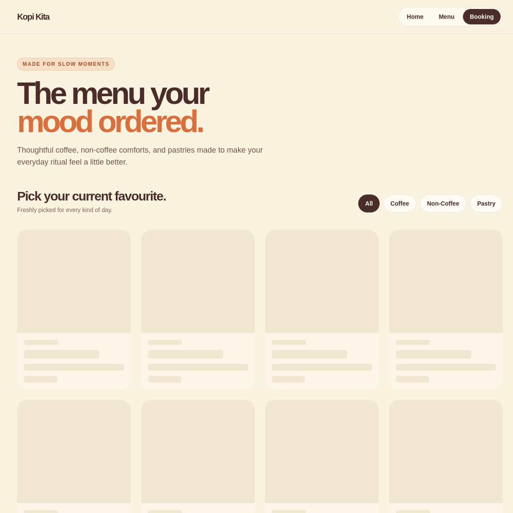
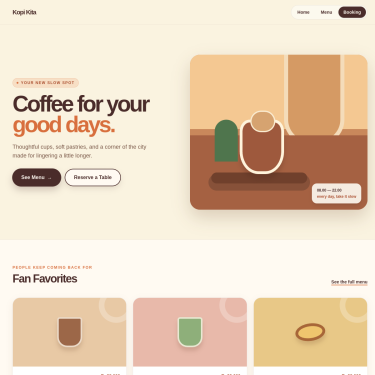
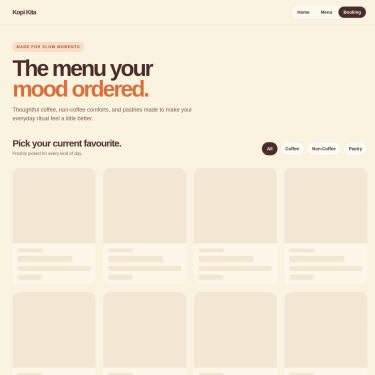
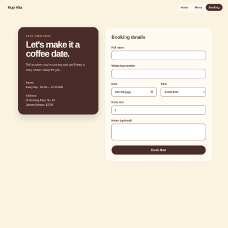

# Kopi Kita production UI teardown

All captures are from production: `https://kopi-kita-rust.vercel.app`, recorded 12 October 2026. This is a backlog only; no UI code is included in this commit.

## 1. [P1] Two hero CTAs share the same visual weight
Screen: `/` at 1280px  
Screenshot:   
Principle: hierarchy — one primary action per screen  
Problem: “See Menu” and “Reserve a Table” sit as adjacent, similarly sized button treatments, so the hero does not make the next action unambiguous.  
Proposed fix: make the research-backed takeaway path primary in its future context; keep the other hero action as a lower-emphasis outline/link action.

## 2. [P1] The booking flow begins without explaining the outcome
Screen: `/booking` at 1280px  
Screenshot:   
Principle: hierarchy  
Problem: the booking fields compete with introductory copy, leaving the time-sensitive task without a concise promise of what confirmation means.  
Proposed fix: place a short, task-specific heading and key expectation directly above the form.

## 3. [P2] Product card imagery dominates price and product information
Screen: `/menu` at 1280px  
Screenshot:   
Principle: hierarchy  
Problem: equal-sized illustration blocks make a scanned menu feel like a gallery; price and product name require more deliberate reading.  
Proposed fix: give product name and price a stable high-contrast row and reduce decorative image prominence.

## 4. [P2] Decorative cards are an AI-slop pattern
Screen: `/` at 1280px  
Screenshot:   
Principle: hierarchy; **AI slop sign: three uniform cards in a row**  
Problem: the three Fan Favorites cards have nearly identical size, radius, and visual weight, so none communicates why it is a favorite.  
Proposed fix: introduce a meaningful featured treatment or make the section a tighter, less dominant support module.

## 5. [P2] Rounded corners and shadows are applied too uniformly
Screen: `/` at 1280px  
Screenshot:   
Principle: depth; **AI slop sign: every surface looks equally elevated**  
Problem: hero art, cards, map, and controls all rely on large radii and soft shadows, reducing the distinction between interactive and decorative surfaces.  
Proposed fix: define a small radius/elevation scale and reserve stronger depth for interactive floating surfaces.

## 6. [P2] Navigation treatment competes with the page task
Screen: `/` at 375px  
Screenshot:   
Principle: hierarchy  
Problem: the compact navigation state leaves little contextual guidance for choosing menu versus booking on a first visit.  
Proposed fix: make the mobile menu expose one clearly labelled primary task and visually de-emphasize secondary navigation.

## 7. [P3] Section labels use accent color more often than necessary
Screen: `/` at 1280px  
Screenshot:   
Principle: color — accent should be scarce  
Problem: orange is used for multiple eyebrow labels and hero emphasis, which weakens its ability to signal a single priority.  
Proposed fix: reserve orange for a small set of state/priority signals and use muted brown for supporting labels.

## 8. [P3] Product descriptions have inconsistent scan priority
Screen: `/menu` at 375px  
Screenshot:   
Principle: spacing and hierarchy  
Problem: compact cards must carry title, price, description, and decorative art in a narrow width, making the supporting description compete with the decision information.  
Proposed fix: constrain descriptions to two lines and keep a consistent internal gap scale.

## 9. [P3] Booking fields need stronger grouping
Screen: `/booking` at 375px  
Screenshot:   
Principle: spacing — gaps within groups must be smaller than gaps between groups  
Problem: customer details, date/time, party size, and notes appear as one long form sequence rather than clearly separated task groups.  
Proposed fix: group fields with headings and use a documented 4/8px spacing scale inside each group, with larger gaps between groups.

## 10. [P3] Color alone carries too much of the active-state meaning
Screen: `/menu` at 1280px  
Screenshot:   
Principle: color and accessibility  
Problem: category selection depends primarily on a filled color treatment, which is weaker under low contrast or for visitors with color-vision differences.  
Proposed fix: pair the visual treatment with clear selected semantics, text, and a non-color indicator.

## Review notes

Priorities are intentionally concentrated on task clarity before cosmetics. Problems 4 and 5 share the same root cause: a component vocabulary without enough distinction between featured, supporting, and decorative surfaces.
